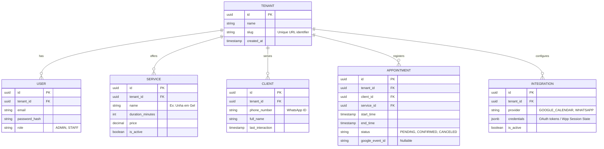

# 🚀 Projeto Matriz: Lypsyos SaaS

## 1. Visão Geral e Arquitetura
O **Lypsyos** é uma plataforma SaaS multitenant projetada para automatizar o agendamento de serviços. O MVP é direcionado a manicures e pedicures, mas sua infraestrutura de dados e lógica de negócios são concebidas de forma genérica para atender clínicas, barbearias, consultorias, etc.

*   **Backend:** Python + Django REST Framework (DRF)
*   **Frontend:** React.js (Mobile-First, Vite)
*   **Banco de Dados (BaaS):** Supabase (PostgreSQL) utilizando *Row Level Security (RLS)* para isolamento perfeito entre *tenants*.
*   **Integrações:** Google Calendar API (OAuth2) e WhatsApp via protocolo Web (persistência de sessão).

---

## 2. Estrutura de Diretórios (Monorepo)
Adotaremos uma abordagem de monorepo para facilitar o desenvolvimento local e garantir versionamento conjunto de contratos de API.

```text
lypsyos/
├── backend/                        # Aplicação Django (DRF)
│   ├── manage.py
│   ├── requirements.txt
│   ├── config/                     # Configurações globais (settings, urls)
│   └── apps/
│       ├── core/                   # Modelos base, Multitenancy, Usuários e Tenants
│       ├── catalog/                # Gestão de Serviços prestados (genérico)
│       ├── scheduling/             # Agendamentos, Clientes, Lógica de Horários
│       ├── integrations/           # OAuth do Google Calendar
│       └── bot/                    # Lógica da Máquina de Estados do WhatsApp
│
├── frontend/                       # Aplicação React.js
│   ├── package.json
│   ├── vite.config.js
│   └── src/
│       ├── assets/                 # Imagens, Ícones, Estilos globais
│       ├── components/             # Componentes de UI genéricos (Botões, Modais)
│       ├── features/               # Lógica de negócio (Booking, Dashboard, Auth)
│       ├── hooks/                  # Custom hooks (ex: useTenant, useAuth)
│       ├── services/               # Clientes de API (Axios/Fetch configurados)
│       ├── store/                  # Gerenciamento de estado global (Zustand/Redux)
│       └── utils/                  # Formatadores, validadores
│
├── whatsapp-worker/                # (Opcional/Microsserviço) Worker Node.js para Baileys/whatsapp-web.js
│   └── index.js                    # Interface com a rede do WhatsApp conectada ao backend
│
└── docker-compose.yml              # Orquestração local dos serviços
```
*(Nota sobre o WhatsApp: Dada a estabilidade de bibliotecas de WhatsApp Web, a conexão direta com a rede pode rodar num microsserviço Node.js isolado, que se comunica via HTTP/Redis com o backend Python).*

---

## 3. Diagrama de Entidade-Relacionamento (ER) - Supabase
Focado em multitenancy. A chave `tenant_id` será nossa âncora de segurança em 100% das tabelas.



---

## 4. Mapeamento de Endpoints (API REST)

**Autenticação e Core**
*   `POST /api/v1/auth/login/` - Autenticação de staff/admin.
*   `GET /api/v1/tenants/me/` - Retorna os dados do tenant do usuário autenticado.

**Catálogo e Serviços**
*   `GET/POST /api/v1/services/` - Listar/Criar serviços do tenant.
*   `PUT/DELETE /api/v1/services/{id}/` - Atualizar/Remover serviços.

**Agendamentos (Scheduling)**
*   `GET /api/v1/appointments/` - Listagem de agendamentos (para o Dashboard).
*   `POST /api/v1/appointments/` - Criar novo agendamento (via Bot ou Dashboard).
*   `GET /api/v1/appointments/availability/` - **Endpoint Crítico:** Consulta regras de negócio locais + chamadas em tempo real ao Google Calendar para retornar horários livres em um dia específico.

**Integrações e Webhooks**
*   `GET /api/v1/integrations/google/auth-url/` - Gera URL do OAuth2.
*   `POST /api/v1/integrations/google/callback/` - Recebe o code e salva os tokens no Supabase.
*   `GET /api/v1/integrations/whatsapp/qr/` - Solicita a geração do QR Code da sessão para pareamento.
*   `POST /api/v1/webhooks/whatsapp/incoming/` - Rota onde o worker do WhatsApp injeta as mensagens recebidas.

---

## 5. Máquina de Estados do Bot de WhatsApp

O chatbot funcionará como uma Máquina de Estados Finitos (FSM) vinculada ao `client_id` (número de telefone) e persistida no Redis ou Banco de Dados temporário.

*   **Filtro Inicial (Gatilho):**
    *   O número do remetente está na agenda do profissional? (Se sim, ignora, a menos que acionado pela palavra-chave, ex: `#agendar`).
    *   É um número desconhecido? (Se sim, responde a primeira mensagem com Greeting).

**Fluxos de Estado (State Machine):**
1.  **`STATE_IDLE`:** Aguardando mensagem.
    *   *Transição:* Mensagem recebida (passa pelo Filtro Inicial) -> Envia saudação e lista de Serviços -> Vai para `STATE_AWAITING_SERVICE`.
2.  **`STATE_AWAITING_SERVICE`:**
    *   *Transição:* Usuário digita o número do serviço. Valida o serviço -> Pede a data desejada -> Vai para `STATE_AWAITING_DATE`.
3.  **`STATE_AWAITING_DATE`:**
    *   *Transição:* Usuário informa "Hoje", "Amanhã" ou "15/10". Sistema busca `availability` (Cruzando com Google Calendar) -> Lista horários -> Vai para `STATE_AWAITING_TIME`.
4.  **`STATE_AWAITING_TIME`:**
    *   *Transição:* Usuário escolhe "14:00". Sistema verifica disponibilidade simultânea -> Confirma o agendamento -> Salva no Banco e no Google Calendar -> Retorna mensagem de sucesso -> Retorna para `STATE_IDLE`.

---

## 6. Checklist de Implementação (Roadmap)

### Fase 1: Fundação e Modelagem (Concluída)
- [x] Definição da Arquitetura Matriz (`project_matrix.md`).
- [x] Inicializar repositório Git e criar estruturas de pastas (Backend e Frontend).
- [x] Configurar Supabase Project (Database, Roles preliminares) - *Via `.env.example` e documentação*.
- [x] Inicializar projeto Django + DRF.
- [x] Criar modelos (`Tenant`, `User`, `Client`, `Service`, `Appointment`, `Integration`).
- [x] Configurar Middleware/Permissions no Django para garantir segurança Multitenant (via `TenantAwareViewSetMixin`).

### Fase 2: Regras de Negócio Core (Backend) (Concluída)
- [x] Implementar CRUD de Serviços e Dashboard admin (via Serializers e ViewSets).
- [x] Implementar OAuth2 do Google Calendar (Fluxo de autorização e salvamento de Refresh Tokens).
- [x] Desenvolver serviço de sincronização Free/Busy: `get_available_slots(date, tenant_id)`.
- [x] Lógica transacional de salvar o agendamento no Supabase e enviar evento para o Google Calendar.

### Fase 3: Worker do WhatsApp e Bot (Concluída)
- [x] Subir Worker do WhatsApp (via biblioteca capaz de gerar QR Code e extrair sessão auth, ex: Baileys/Node.js).
- [x] Integrar persistência da sessão do WhatsApp no Supabase (para resistir a reboots) - *Adaptação: Session storage local preparado para Custom Adapter*.
- [x] Implementar a Máquina de Estados em Python (recebendo webhooks do worker).
- [x] Implementar o Filtro de Privacidade (ignorar contatos salvos/pessoais salvo gatilho).

### Fase 4: Frontend (Mobile-First UI)
- [ ] Setup do Vite + React + TailwindCSS (ou biblioteca UI escolhida).
- [ ] Componente Layout (Responsividade garantida: visual de app no celular, dashboard alinhado no PC).
- [ ] Tela de Autenticação.
- [ ] Tela de Configurações (Ler QR Code WhatsApp, Botão "Conectar Google").
- [ ] Dashboard Geral (Lista de agendamentos do dia).
- [ ] CRUD de Serviços (Tela de edição de preços, durações).

### Fase 5: Testes e MVP
- [ ] Testes de concorrência (dois clientes agendando ao mesmo tempo pelo WhatsApp).
- [ ] Verificação de quedas de sessão web do WhatsApp e mecanismos de autorestart.
- [ ] Deploy do Backend (ex: Render, Railway) e Frontend (Vercel, Netlify).

